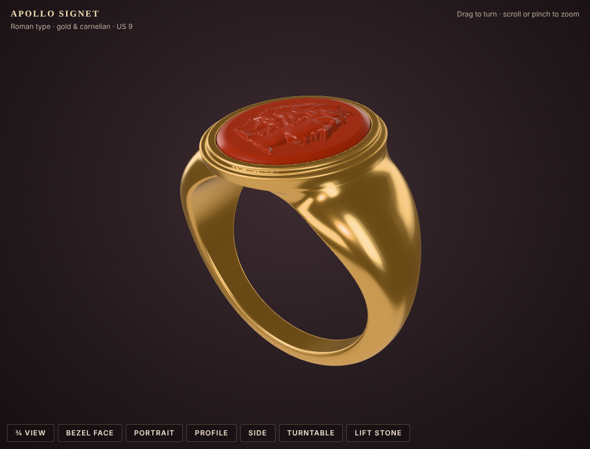
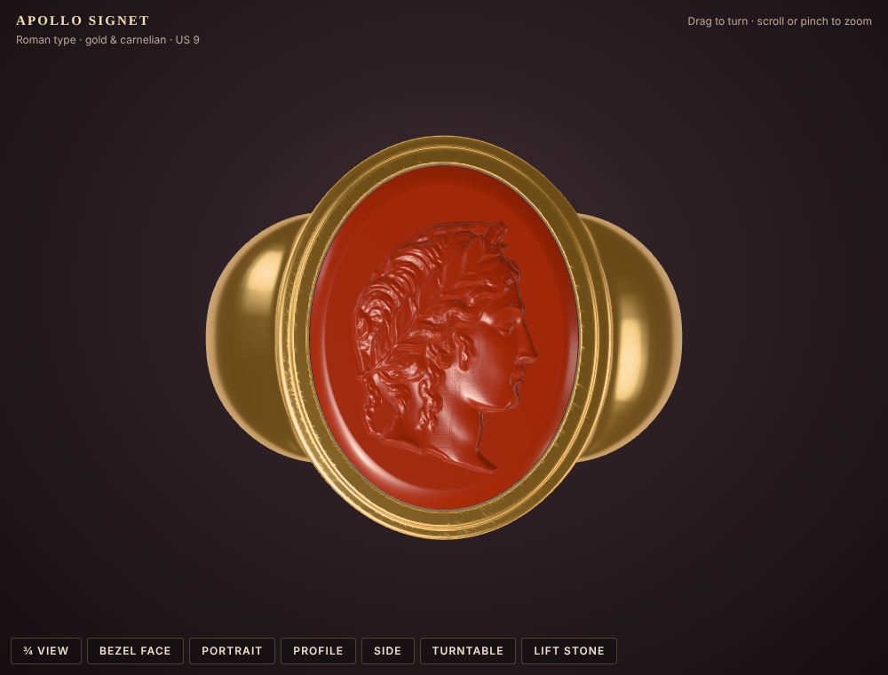
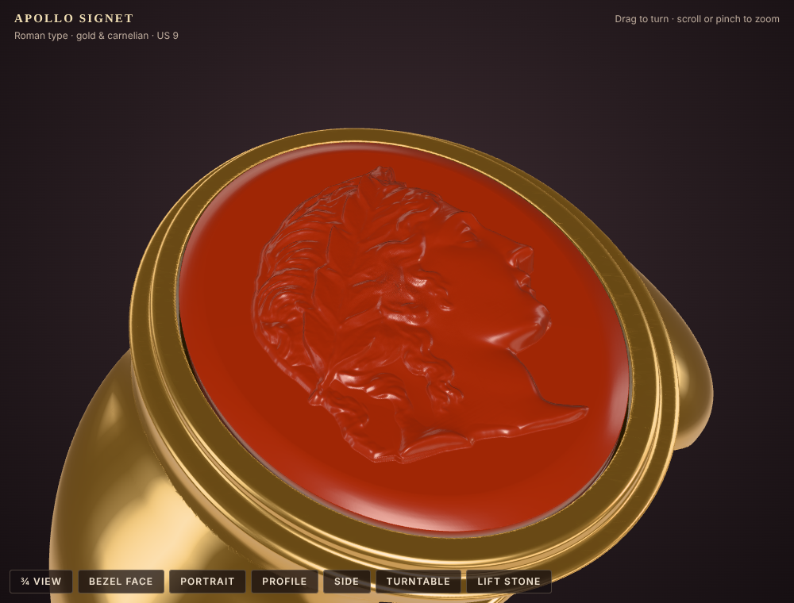

# Apollo Signet Ring

A Roman-style gold signet ring set with a carnelian carrying a laureate head of Apollo, ready for 3D printing.
Ring size US 9 (inner diameter 18.95 mm); the generator in `source/` makes other sizes.

**[Open the interactive 3D viewer](https://htmlpreview.github.io/?https://github.com/chennakeshavadasa/Apollo_Signet_ring/blob/main/viewer/apollo_signet_viewer.html)** (turn, zoom, preset views; nothing to install)

<p align="center"></p>
<p align="center">
  
  
</p>

## Which file do I print?

All print files are in [`print/`](https://github.com/chennakeshavadasa/Apollo_Signet_ring/tree/main/print), in millimetres. Pick **one** of the three folders:

| Your printer / goal | Print | Notes |
|---|---|---|
| **Multi-colour FDM printer** (Bambu AMS, Prusa MMU, ...) | [`print/multi-colour/apollo_signet_2colour.3mf`](print/multi-colour/apollo_signet_2colour.3mf) | One file with the gold body and the red stone already assembled. If the slicer does not assign the filaments by itself, give `ring_body_gold` the gold filament and `apollo_stone_red` the red one. |
| **Resin (MSLA) printer**, or any single-colour printer when you want two colours | [`print/two-part/ring_body_gold.stl`](print/two-part/ring_body_gold.stl) **and** [`print/two-part/apollo_stone_red.stl`](print/two-part/apollo_stone_red.stl) | Print the body in gold/yellow and the stone in red, then glue the stone into its seat. Gives the sharpest portrait. |
| **One colour only**, or a pattern for **lost-wax casting** in metal | [`print/one-piece/ring_one_piece.stl`](print/one-piece/ring_one_piece.stl) | Body and stone fused into one solid; the fitting gap is closed. |

**Best result:** a resin printer with the two-part STLs. The portrait has detail down to about 0.05 mm (eye, lips, laurel veins).

### Printing tips

- Print a quick test of the ring body first to confirm the finger size.
- **Stone:** print it flat side down; it needs no supports. On FDM use a 0.2 mm nozzle and 0.06-0.08 mm layers (a 0.4 mm nozzle softens the face).
- **Ring body:** put the supports on the inside of the band and under the bezel; keep them off the top of the bezel and the collet.
- **Fit:** the seat has 0.10 mm clearance all round. If the stone is tight, scale it to 99 % in X and Y; if it is loose, a drop of CA glue holds it.

## View it in 3D

**Online:** [open the viewer](https://htmlpreview.github.io/?https://github.com/chennakeshavadasa/Apollo_Signet_ring/blob/main/viewer/apollo_signet_viewer.html).
With GitHub Pages turned on for this repository (*Settings > Pages > Build and deployment: Deploy from a branch, `main`, `/ (root)`*), it is also at
[https://chennakeshavadasa.github.io/Apollo_Signet_ring/viewer/apollo_signet_viewer.html](https://chennakeshavadasa.github.io/Apollo_Signet_ring/viewer/apollo_signet_viewer.html).

**Offline:** download [`viewer/apollo_signet_viewer.html`](viewer/apollo_signet_viewer.html) and double-click it; it is a single file that opens in any browser.

Drag to turn, scroll or pinch to zoom, and use the buttons for the preset views, a turntable and **Lift stone** (shows the seat).

[`viewer/apollo_signet_coloured.glb`](viewer/apollo_signet_coloured.glb) is the full-resolution coloured model for Blender, Windows 3D Viewer and other 3D programs.

## Design

The gold body follows the Roman gold gem-set signet rings of the 1st-2nd century AD (Henig types II/III):

- a D-section hoop, flat inside (no modern comfort fit), slender at the back and swelling into broad shoulders;
- a flat oval bezel with a stepped collet round the stone;
- the carnelian stands proud of the gold, as on Roman signets, where the gem face is the top of the ring.

### Measurements (mm)

| | |
|---|---|
| Bezel plate | 14.4 x 17.6 |
| Collet | 13.1 x 16.3 |
| Stone | 11.4 x 14.6 |
| Stone seat | 11.6 x 14.8, 0.70 deep, 0.10 clearance all round |
| Hoop | 1.8 thick x 2.8 wide at the back; 3.1 x 11.5 at the shoulders |
| Stone face | 0.35 above the gold |
| Portrait relief | 0.90; its top is 1.25 above the gold |
| Height above the finger | 2.7 (gold), 3.95 (with the stone) |

### Casting in metal

Solid body volume 1,129 mm³: about 17 g in 18k gold, 15 g in 14k gold, 12 g in sterling silver.
The stone can be cast in red resin or glass, or carved in real carnelian from the height map in [`portrait/`](https://github.com/chennakeshavadasa/Apollo_Signet_ring/tree/main/portrait).

## Make another ring size

```bash
pip install -r source/requirements.txt
python3 source/build_ring.py --us-size 10 --out out
cd source/viewer-build && npm install && node build.mjs ../../out/build/viewer_payload ../../out/viewer/apollo_signet_viewer.html
```

`out/` then has the same `print/` and `viewer/` folders as this repository (`--out .` refreshes the repository's own files).

## Repository layout

```
print/
  multi-colour/   apollo_signet_2colour.3mf                    multi-colour FDM printers
  two-part/       ring_body_gold.stl, apollo_stone_red.stl     resin or single-colour printers, two colours
  one-piece/      ring_one_piece.stl                           one colour, lost-wax casting
viewer/           apollo_signet_viewer.html (3D view in the browser), apollo_signet_coloured.glb
images/           renders from the viewer
portrait/         Apollo portrait height map: 16-bit PNG (white = highest) and the .npy the generator reads
source/
  build_ring.py   ring generator (writes print/, viewer/*.glb and the viewer payload)
  requirements.txt
  viewer-build/   builds viewer/apollo_signet_viewer.html (three.js, esbuild)
```
